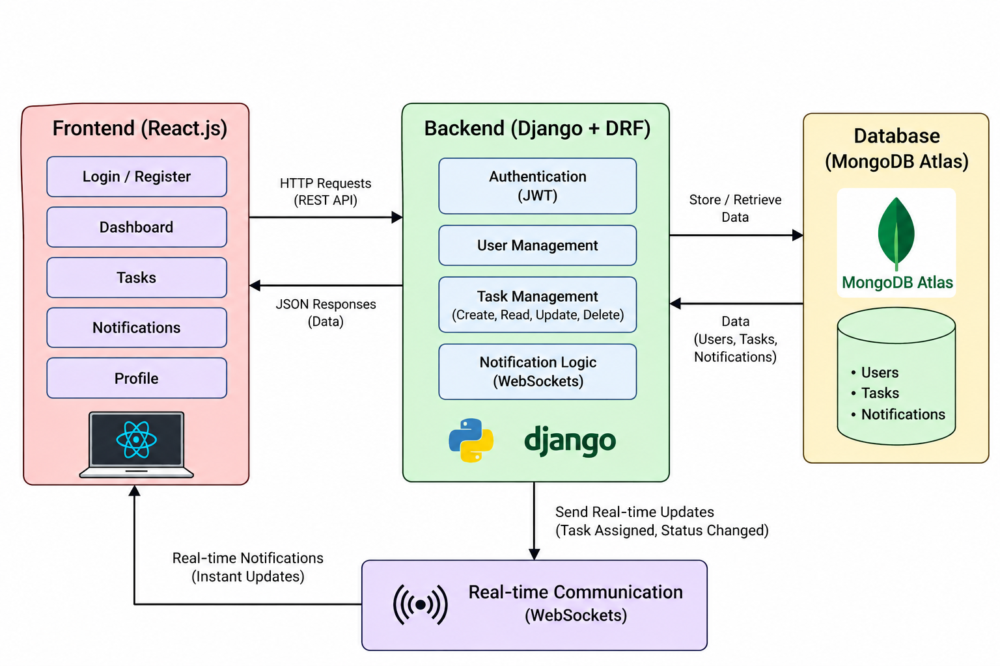

# Task Management System

A web-based Task Management System designed to help teams create, assign, track, and manage tasks through a centralized platform.

The system provides separate access for administrators and team members, along with real-time notifications for task assignments and status updates.

---

## Features

### Authentication
- User registration and login
- JWT-based authentication
- Role-based access for Admin and Team Members

### Task Management
- Create and assign tasks
- Assign tasks to multiple team members
- Set task priority and deadline
- Update task status
- View assigned tasks
- Delete tasks
- Track task progress

### Dashboard
- Overview of total tasks
- Completed tasks
- In-progress tasks
- Pending tasks
- Recent task information

### Notifications
- Notifications for task assignments
- Real-time task updates using WebSockets
- Notification history

### User Profile
- View user details
- Display account role
- Logout functionality

---

## System Architecture



The application follows a three-layer architecture:

- **Frontend:** React.js
- **Backend:** Django REST Framework
- **Database:** MongoDB Atlas

REST APIs are used for communication between the frontend and backend, while WebSockets provide real-time notifications.

---

## Technology Stack

| Layer | Technology |
|---|---|
| Frontend | React.js |
| Backend | Django |
| API | Django REST Framework |
| Database | MongoDB Atlas |
| Authentication | JWT |
| Real-time Communication | WebSockets |
| Programming Languages | JavaScript, Python |
| Development Tools | VS Code, Git, GitHub |

---

## Project Structure

```text
Task-Management-System/
│
├── frontend/
│   ├── src/
│   │   ├── components/
│   │   ├── pages/
│   │   ├── routes/
│   │   ├── services/
│   │   ├── context/
│   │   ├── App.jsx
│   │   └── main.jsx
│   │
│   ├── public/
│   ├── package.json
│   └── index.html
│
├── backend/
│   ├── manage.py
│   ├── .env
│   ├── requirements.txt
│   └── ...
│
├── docs/
│   └── system-architecture.png
│
└── README.md
